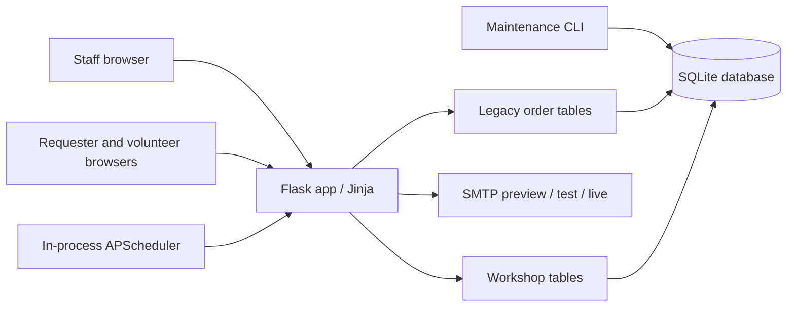
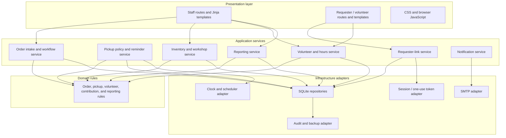
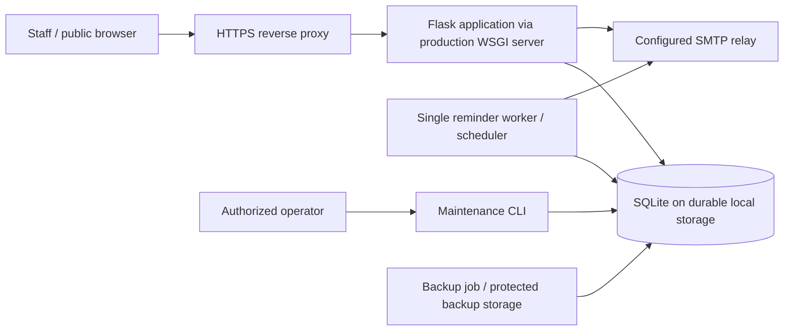

# PIF Portal — Proposed Architecture

> Prepared: 2026-11-24 (owner clarifications incorporated)  
> **Owner review status: APPROVED by project owner — 2026-11-23**  
> Based on the supplied PIF Portal project documents, the 2026-11-23 read-only audit of `main` at `029a613` (local HEAD) | `origin/main` `00c864b`, and owner clarifications dated 2026-11-24  
> Full code audit completed: 2026-11-23

This document proposes a target architecture for owner review. It is deliberately conservative: preserve the existing Flask/SQLite application while correcting operational boundaries and making business rules explicit. It does not authorize a rewrite, a database migration, or a deployment change.

## 1. Architectural intent

The application should remain understandable as a small, cohesive portal until measured needs justify a larger deployment topology. The architecture should:

- separate product rules from HTTP routes and templates;
- isolate persistence, email, scheduling, and token handling behind explicit interfaces;
- make schema changes explicit, versioned, and auditable;
- preserve the distinction between staff-authenticated operations and public attribution forms;
- make email and reminder side effects safe, observable, and repeatable;
- protect the active historical database during the Excel cutover process; and
- support a production runtime without relying on Flask's development server or import-time scheduler startup.

**Not a goal at this stage:** converting to microservices, replacing SQLite, introducing a SPA, or changing product semantics before owner decisions are recorded.

## 2. Three-layer development workflow

This proposal uses the requested framework as a disciplined separation of concerns:

| Layer | Governing artifact | Owns | Must not silently do |
|---|---|---|---|
| 1. Specification | `SPECIFICATION.md` | Product goals, actor needs, business rules, acceptance criteria, scope, exclusions, and unresolved decisions | Dictate a technical implementation merely because one exists today. |
| 2. Architecture | `ARCHITECTURE.md` | Component boundaries, data ownership, interfaces, security boundaries, deployment topology, and operational qualities | Redefine product rules or resolve owner decisions by assumption. |
| 3. Implementation | Source code, migrations, tests, runbooks, and `TRACEABILITY_MATRIX.md` | Deliver approved requirements and demonstrate conformance | Treat tests or existing behavior as proof that a requirement was approved. |

Change flow: requirement change → owner decision → architecture impact review → implementation and tests → traceability update. A code change must not be used to backfill an undocumented product decision.

## 3. Current-state architecture (audit-verified)

The current system is a server-rendered Flask application with SQLite persistence, standard-library SMTP, and an in-process APScheduler reminder job.

Current characteristics:

- Flask 3.1.3, Jinja templates, Python 3.14.7 in the audited environment.
- SQLite 3.53.4, selected by `DB_PATH`; default code path `data/processed/pif.db`.
- Staff session stores a username after Werkzeug password-hash verification.
- Custom session-bound signed form tokens exist for mutation forms; no global CSRF extension was found.
- Email uses SMTP STARTTLS with preview, disabled, test-sink, and live modes.
- Flask-APScheduler / APScheduler runs a 15-minute pickup-reminder job in-process.
- Bootstrap, fonts, Chart.js, jQuery, and DataTables are CDN-loaded.
- Order, workshop, volunteer, and maintenance responsibilities are split among modules, but `app.py` remains a central application entry and route surface.
- Order/link/pickup schema may be created during request handling; workshop schema requires a controlled CLI initialization.

These are verified current-state facts. They are not all confirmed long-term architectural decisions.

## 4. Proposed logical architecture

### 4.1 Layers inside the application

This is a proposed logical decomposition, not a requirement to create a large number of packages or services immediately. Keep deployment as a single application initially unless measured scaling or security needs justify separation.

### 4.2 Presentation layer

Responsibilities:

- Render staff workflows and public forms.
- Validate request shape and present field errors.
- Enforce route-level authentication and authorization checks.
- Avoid embedding business policy or SQL-heavy workflow logic in route handlers.
- Keep public routes distinct from staff-only routes and apply the public cache/referrer/robots policy consistently.

Suggested route groups / blueprints (names illustrative):

- `auth`: login, logout, session lifecycle.
- `orders`: order desk, intake, transitions, explorer.
- `requester`: expiring one-use requester flow.
- `workshop`: inventory and workshop operations.
- `volunteer`: public attribution forms and staff volunteer management.
- `reports`: approved reports only.

### 4.3 Application services

Services orchestrate use cases and transactions. Initial service boundaries should follow business capabilities already present:

- `OrderService`: validate and create requests, transition order lines, maintain submission idempotency.
- `PickupService`: calculate eligibility/deadlines, claim reminder deliveries, record results.
- `RequesterLinkService`: issue, validate, expire, and consume one-use links.
- `WorkshopService`: manage inventory and contribution records.
- `VolunteerService`: manage volunteer profiles, hours, corrections, voids, and public submissions.
- `ReportingService`: compute only metrics with approved definitions.
- `NotificationService`: request confirmation/reminder delivery after the relevant transaction commits.

Bulk intake is an entry convenience for an individual or Pedal Partner sponsor. Each submitted recipient line is a separate one-bike request with its own status and availability-driven processing timeline. Do not model the batch as one fulfilment lifecycle. A shared batch reference may be considered later for audit/search, but is not currently approved. Reporting expansion is low priority; the initial business goal is bikes processed by year and shop, with pickup-date/completed-line semantics as the candidate baseline.

### 4.4 Domain rules

Keep policy decisions testable without Flask, SMTP, or SQLite. Examples:

- allowed order status transitions;
- pickup eligibility and deadline calculations;
- one-use requester-link lifecycle;
- volunteer-hours validation and correction/void semantics;
- inventory tag normalization and uniqueness (pending owner decision);
- approved reporting definitions.

Domain functions should receive explicit dates/times rather than reading wall-clock time implicitly. This supports deterministic tests and reproducible reminder decisions.

### 4.5 Infrastructure adapters

Use explicit adapters for:

- SQLite connection creation and repository operations;
- schema versioning and migration execution;
- SMTP delivery and email preview storage;
- token signing / secret configuration;
- scheduler invocation and durable reminder claims;
- backups, audits, and controlled repairs.

SQLite-specific behavior such as `PRAGMA foreign_keys=ON` must be configured centrally for every connection path, not inconsistently by individual modules.

## 5. Proposed data and persistence approach

### 5.1 Preserve current data until migration governance is approved

The active database was not inspected by the audit. Do not assume its schema matches tracked design documentation, and do not replace it based on test databases or the older CSV rehearsal.

Before any production schema change:

1. identify the authoritative active database path without exposing private data;
2. take and verify a restorable backup;
3. inspect the active schema and migration state;
4. run an additive migration rehearsal against a copy;
5. record row counts and reconciliation outcomes without disclosing personal data;
6. obtain owner sign-off; and
7. define rollback and post-cutover verification.

### 5.2 Versioned schema lifecycle

**Proposal:** use one explicit, versioned migration mechanism for all schema changes. Request handlers should not create tables or mutate schema as a side effect of user traffic. Startup/readiness should check that the expected schema version is present and fail with a clear operator message rather than attempting an implicit upgrade.

This replaces the current split lifecycle only after a migration plan is approved and tested against the actual database.

### 5.3 Referential integrity

**Proposal:** enable foreign-key enforcement for every SQLite connection and progressively add declared constraints where data quality and compatibility permit. Audit the legacy order tables first; do not add constraints that would fail or discard existing records without a reconciliation plan.

### 5.4 Order and tag model remain owner decisions

The current database treats each `orders` row as a recipient/bike line and has no durable multi-bike order header. The Order Desk's grouping is display-only. The inventory accepts a wider tag format than order completion.

Do not implement a schema redesign until the owner decides:

- whether a multi-recipient request is a durable parent request with child lines or independent records;
- what identifiers and duplicate rules apply; and
- whether order tags remain numeric or adopt inventory's wider text format.

If a durable parent is approved, model the request and its bike/order lines explicitly, preserve existing IDs, and plan a reversible migration. If not, document that the grouping is presentational only.

## 6. Authentication, authorization, and public trust boundaries

### 6.1 Staff boundary

Proposed minimum production controls:

- Require a high-entropy `SECRET_KEY` from protected environment configuration; no source fallback.
- Never run `debug=True` in a reachable production process.
- Use secure, HTTP-only, appropriately scoped session cookies; enable `Secure` under HTTPS.
- Define trusted reverse-proxy handling before accepting forwarded headers.
- Use POST plus CSRF protection for state-changing actions, including logout.
- Add login throttling and a documented account disable/reset procedure.
- Define staff roles only after the owner decides whether all staff are equivalent.
- Log security-relevant events without logging passwords, secrets, email bodies, or unnecessary personal data.

These are proposed production controls, not evidence of previously approved feature requirements.

### 6.2 Public requester and volunteer boundary

Preserve the existing distinctions unless the owner decides otherwise:

- Requester links are capability tokens: random, high-entropy, expiring, one-use; persist only a hash.
- Public volunteer identity selection attributes a submission to a volunteer record but does not authenticate that person.
- Public forms should retain restrictive cache, referrer, and indexing behavior.
- Define rate limits, abuse monitoring, privacy/retention, and recovery from mistaken attribution before wider deployment.
- QR links must not be generated until the public hostname and HTTPS behavior are approved.

## Production deployment target (owner-confirmed hosting context)

The production host is a Debian server located at the organization's main location, expected to run 24/7. The owner/developer will connect remotely to update and maintain it. This is now a confirmed deployment context, replacing the earlier open question about whether production would be local or hosted elsewhere.

The following remain architecture decisions, not assumed facts:

- WSGI server and process model (for example, a single managed application process versus multiple workers).
- Reverse proxy, HTTPS certificate handling, firewall exposure, and trusted forwarded headers.
- Secure remote administration method, named operator access, and update/rollback procedure.
- Single owner for APScheduler or a separate scheduled worker; exactly one reminder scheduler must be active.
- Backup destination (preferably separate from the server), retention, restore test, and RPO/RTO.
- Monitoring, alerting, disk-space checks, log rotation, and power/network outage recovery.

The 24/7 requirement is an availability expectation for the host, not a claim that the current Flask development server or scheduler is production-ready. The proposed production topology must explicitly disable debug mode, require a private `SECRET_KEY`, and document service restart and recovery behavior.

## Owner-confirmed domain architecture: bulk orders

A bulk submission may be made by an individual or a Pedal Partner organization/group sponsoring recipients. It reduces repeated data entry; it does not create a single multi-bike fulfilment unit. Each recipient line represents one bike request and is processed independently according to bike availability. Status transitions, contact timing, pickup date, and completion remain per bike request. The current one-row-per-recipient model is consistent with this rule. Do not add shared completion state or an order-header entity as a prerequisite. If operational traceability later requires a common submission/batch ID, add it as a grouping/provenance field without changing per-request lifecycle semantics, subject to approval.

## Owner-confirmed reporting priority

Expanded reporting is low priority. The owner confirms the practical measure is total bikes processed by year and shop, using pickup date as the year basis. Missing shop values default to Bentonville. The implementation should retain provenance so a defaulted Bentonville value can be distinguished from a source-confirmed value. Continue counting completed one-bike order lines; do not substitute distinct inventory tags or grouped submissions.

## 7. Email and background work

## 7.1 Email adapter

Preserve safe defaults: preview/disabled by default; live delivery requires explicit flags. Keep SMTP credentials outside source control. Add a documented sender policy, test-recipient allowlist, preview retention policy, and operator approval gate.

Email should be triggered after the relevant database transaction commits. The service should distinguish “business operation committed” from “notification delivered.” Delivery failures must be visible and retryable without repeating the business transaction.

**Future option, not a decision:** a transactional outbox can provide durable notification intent. Introduce it only if the owner approves the operational complexity and the existing claim/receipt behavior is insufficient.

## 7.2 Scheduler ownership

**Proposal:** do not start APScheduler as a side effect of importing the Flask application. Run reminder scheduling in one explicitly owned process or service. The web application may expose the reminder service, but only one scheduler instance should claim due work.

Required properties:

- exactly one scheduler owner per environment;
- durable claim/lease before sending;
- idempotent delivery identity;
- bounded retry and failure visibility;
- logs/metrics for due, claimed, sent, skipped, and failed reminders;
- documented behavior during deploy/restart and clock/time-zone changes.

The current 15-minute interval may be retained provisionally, but confirm whether that cadence is a product rule or an implementation choice.

## 8. Reporting and performance

Only the Bike Distribution report is implemented. It counts completed order-line/bike records by pickup date/shop/month; it must not be labeled as a deduplicated physical-bike or grouped-order count.

Before adding volunteer-hours or workshop-activity reports, approve:

- the metric definition and unit;
- time-zone and date-boundary rules;
- grouping/filter dimensions;
- who may see person-level versus aggregate data; and
- treatment of corrected and voided records.

Current order browsing loads all matching rows into Python before filtering and pagination. Measure actual data volume and response time before optimizing. If needed, move search, filters, grouping, and pagination into indexed SQL queries while preserving current behavior through regression tests.

## 9. Production deployment proposal

A conservative first production topology is:

This is a logical proposal only. Owner direction is Debian hosting, with Tailscale as the remote-administration basis. Initial deployment is intended as a one-time setup, followed by remote maintenance and updates. Prefer the organization site only if its internet connection reliably supports staff access and public requester/volunteer links; otherwise evaluate hosting from the developer's home. This is an owner-selected direction, not evidence that Tailscale or either host is already configured. The production WSGI server, service manager, reverse proxy/TLS, public DNS/reachability, firewall policy, backup target, and monitoring still require design and verification.

The production package should include:

- WSGI entry point and production server command;
- environment/configuration reference and validation;
- explicit database and backup paths;
- one scheduler owner;
- health/readiness check;
- structured logs and operational alerts;
- dependency pinning / reproducible install strategy;
- CI test command including the Node test prerequisite;
- automated daily offsite backups for application data and the code repository, with defined retention, encryption/access protection, verification, and a restore runbook/drill;
- account provisioning/revocation procedure; and
- incident and public-form abuse response procedures.

## 9.1 UAT and Google Sheets transition

**Owner-confirmed UAT purpose:** determine whether staff find the portal's functionality acceptable. UAT scenarios should exercise the real operational workflows, including:

- creating individual and bulk submissions;
- reviewing and finding orders;
- moving an order line through its allowed stages;
- completing an order with pickup details;
- handling cancellation and restoration where applicable;
- requester-link submission and other public/staff flows in the agreed release scope; and
- confirming that saved actions, displayed status, and expected notifications behave correctly.

Historical-data ambiguity and cleanup are explicitly outside this UAT objective and will be handled later. Do not make full historical reconciliation a precondition for functional UAT. Use a controlled test dataset or migrated data with unresolved historical fields clearly identified so they do not obscure workflow acceptance.

Google Sheets is intended to be abandoned when staff transition to the portal, rather than retained as a parallel operational source. The cutover plan should identify the final spreadsheet handoff/export, the point at which staff stop entering new operational records in Sheets, the initial portal data load, and how any final changes immediately before the switch are captured. The exact date and sign-off procedure remain open.

## 9.2 Connectivity test and host selection

The owner will test the organization's main-shop internet connection. Since no standardized threshold exists, define a practical test before choosing the host: staff access from expected locations, public requester/volunteer links from external networks, availability during normal operating periods, upload/download behavior, and recovery after an internet or power interruption. Record observed results and decide whether shop hosting is acceptable. If not, evaluate the developer's home as the hosting location. Tailscale is for remote administration; it does not by itself make public application links reachable.

## 9.3 Backup direction

The owner intends **daily offsite backups** of both application data and the code repository. Treat this as a confirmed operational direction, but not a complete backup policy. The deployment design must still define destination, encryption and access control, retention, backup verification, SQLite consistency/WAL handling, restore procedure, recovery-point and recovery-time expectations, and periodic restore tests. A remote Git repository alone is not a substitute for backing up the database and private deployment configuration.

## 10. Frontend and dependency strategy

The current UI is server-rendered with Bootstrap, custom CSS, vanilla JavaScript, and CDN-delivered third-party assets. No frontend bundler is currently required.

**Proposal:** do not introduce a frontend framework merely for architectural fashion. First pin all external asset versions and add integrity metadata where supported, or self-host approved assets if the deployment requires offline/local-network resilience. The owner should decide the acceptable privacy, availability, and update trade-offs.

The existing whiteboard / Sharpie presentation style is part of the current UI; whether it is a durable product requirement should be confirmed from the missing project history.

## 11. Testing and quality gates

Recommended gates before a release:

1. Unit tests for domain policy without I/O.
2. Repository tests against temporary SQLite databases with foreign keys enabled.
3. Route/integration tests for staff and public trust boundaries.
4. Idempotency tests for order submission, requester-link consumption, and reminder delivery.
5. Migration rehearsal and rollback test against a sanitized copy of the active schema.
6. Email tests using mocks or a controlled sink; live delivery separately approved.
7. Scheduler integration test with a single owner and duplicate-worker simulation.
8. Node order-action test run in CI, in addition to the Python suite.
9. Browser/device smoke tests, responsive checks, and accessibility review.
10. Backup restore drill and operational readiness review.

Current baseline: 155 Python tests passed; Node test not run in the audit environment; live SMTP, scheduler operations, browser/device behavior, accessibility, and restore were not verified.

## 12. Decisions deliberately left open

This architecture does not decide:

- production hosting/runtime or network topology;
- whether staff need roles;
- whether public volunteers need authentication;
- whether order headers/durable request grouping are required;
- numeric versus text order tags and duplicate semantics;
- authoritative reporting metrics;
- the active workbook source and historical cutover rules;
- request-time DDL versus explicit migration lifecycle (the proposal favors explicit migrations, but requires owner approval);
- SMTP sender, recipients, retention, and live approval process;
- CDN versus self-hosted assets;
- data retention and privacy policy; or
- whether the current UI layout/navigation decisions should be preserved.

See `SPECIFICATION.md`, Section 9, for the owner question register.

## 13. Architecture decision register

| ID | Proposed direction | Status | Depends on |
|---|---|---|---|
| PA-001 | Keep Flask/Jinja and SQLite initially; avoid a rewrite until measured need exists. | Proposal | Owner approval and expected data volume/hosting constraints. |
| PA-002 | Separate presentation, application services, domain rules, and infrastructure adapters. | Proposal | No product decision required beyond preserving existing behavior. |
| PA-003 | Move all schema changes to explicit versioned migrations. | Proposal | Active schema inspection, backup, migration rehearsal. |
| PA-004 | Enable SQLite foreign keys on every connection. | Proposal | Legacy data audit and constraint compatibility. |
| PA-005 | Remove import-time scheduler startup; assign one scheduler owner. | Proposal | Production runtime choice. |
| PA-006 | Require a configured secret; remove production fallback. | Proposal | Deployment configuration and session revocation plan. |
| PA-007 | Add production WSGI serving, HTTPS/proxy, session, CSRF, and login-abuse controls. | Proposal | Host/proxy and staff-access decisions. |
| PA-008 | Preserve optional inventory and public attribution semantics until owner changes them. | Preserve current documented constraints | Confirm against primary decision history. |
| PA-009 | Do not change order identity or tag model before explicit decisions. | Hold / no change | Q-006 and Q-014. |
| PA-010 | Define metrics before adding reports. | Hold / no change | Q-007 and Q-019. |

## 14. Approval conditions

This architecture remains proposed until the owner approves the hosting model, scheduler ownership, security baseline, migration lifecycle, data-model decisions, and operational responsibilities. No implementation or deployment changes are authorized by this document.
