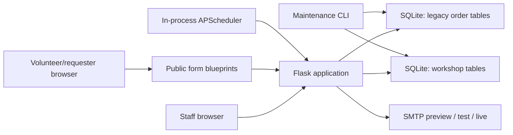

# PIF Portal — proposed technical audit

**Audit date:** 2026-11-23  
**Scope:** read-only repository audit of the `main` checkout at `00c864b389024ec8ed3b28df3d4d93a5c009a9ed`. No source, configuration, schema, dependency, database, or project-document changes were made. No active database contents or `.env` values were read. No real email was sent.

## Executive summary

PIF Portal is a server-rendered Flask and SQLite application that has grown from an order desk into a staff portal with public volunteer-entry forms, optional finished-bike inventory, volunteer time logging, reporting, requester links, email notifications, and a local database-maintenance CLI.

The current Python test suite is healthy: **155 tests passed in 7.09 seconds** using temporary databases and mocked or disabled email paths. The documented Node order-action check could not be run because Node.js is not installed or available on this audit shell. The application is source-tested more thoroughly than it is operationally documented: deployment ownership, production process topology, security hardening, and the actual active database/schema state remain unverified.

The most material technical risks are operational rather than failing tests: a development server entry point with `debug=True`; a fallback session secret in source; all staff accounts sharing the same effective authorization level; no evidenced production WSGI/process/scheduler design; schema changes split between request-time table creation and a manually-run CLI; and several documents that now conflict with the Git state or one another. The historical-data cutover is explicitly not complete and was not assessed against private data.

## Evidence and audit limits

### Verified directly

- Repository code, tracked documentation, Git state, requirements, templates, static assets, and tests.
- The Python virtual environment exists at `.venv` and uses Python 3.14.7 with SQLite 3.53.4.
- `main` matches `origin/main` at the audit revision above.
- `git diff --check` produced no tracked-diff whitespace errors.
- Python unit/integration tests passed with outbound mail disabled at process level; individual tests mock the SMTP layer when exercising delivery behavior.

### Not verified

- Active SQLite schema, data quality, record counts, users, credentials, email settings, and mail delivery. These reside in ignored/private locations and were intentionally not opened.
- Browser visual behavior, responsiveness, accessibility with assistive technology, real SMTP delivery, actual scheduled jobs, production networking, Tailscale, backups, restore, and deployment hosting.
- The untracked `definitions/` reference files were observed but not treated as authoritative or reconciled with code.
- The current port-5004 preview described in older notes was not started or inspected; `app.py` itself runs port 5003 when executed directly.

## Technology inventory

| Layer | Verified implementation |
| --- | --- |
| Runtime | Python 3.14.7 in a checked-in-location local `.venv` (the environment itself is ignored) |
| Web framework | Flask 3.1.3; server-rendered Jinja templates |
| Scheduler | Flask-APScheduler 1.13.1 / APScheduler 3.11.3; in-process 15-minute pickup-reminder job |
| Database | SQLite 3.53.4, configured by `DB_PATH`; default code path `data/processed/pif.db` |
| Authentication | `users` table with Werkzeug password-hash verification and Flask signed session storing a username |
| Forms | Custom, session-bound signed form tokens using `itsdangerous`; no global CSRF extension |
| Email | Standard-library SMTP with STARTTLS; preview, disabled, test-sink, and live modes; no Gmail API/OAuth client in code |
| UI | Bootstrap 5.3 CDN, Patrick Hand Google Font CDN, Chart.js CDN, and jQuery/DataTables CDNs; custom CSS and vanilla JavaScript |
| Testing | Python `unittest`; Node built-in test runner for `tests/test_order_actions.cjs` |
| Packaging/build | `requirements.txt`; no `pyproject.toml`, package lockfile, frontend bundler, or CI configuration found |

Direct external endpoints are CDN assets and the configured SMTP server. The repository contains no API client for Google services or other SaaS integrations.

## Project structure

| Area | Key files | Responsibility |
| --- | --- | --- |
| Application entry | `app.py` | Flask creation, staff login, order desk, new order, order transitions, dashboard, explorer, scheduler |
| Order domain | `order_intake.py`, `order_search.py`, `pickup_policy.py`, `requester_links.py`, `utils.py` | Intake/validation, search/filtering, deadlines/reminders, single-use links, email and display data preparation |
| Database access | `database.py`, `admin_tools.py` | Basic web SQLite connection and maintenance/audit/backup operations |
| Workshop domain | `workshop.py`, `volunteer_entry.py`, `volunteer_impact.py` | Staff inventory/volunteers/hours, public volunteer entries, impact totals |
| Maintenance | `scripts/admin_db.py`, `scripts/migrate_history.py`, `scripts/fix_duplicate_shops.py`, `scripts/fix_person_ids.py` | CLI schema setup, controlled order edits, historical CSV rehearsal, legacy repairs |
| Presentation | `templates/`, `static/css/whiteboard.css`, `static/js/` | Server-rendered UI, Sharpie/whiteboard styling, form and card interactions |
| Tests | `tests/` | 14 Python test modules plus one Node test file |
| Documentation | `README.md`, `PROJECT_NOTES.md`, `design/*.md` | Operational notes, database design, workflow review, reconciliation, and old handoff instructions |

`data/`, `.env`, `.venv`, and generated Python cache are ignored. The current worktree also has a staged `.vscode/extensions.json` and an untracked `definitions/` directory. Their authorship, purpose, and whether they should be committed were not verified.

## Architecture and data flow



### Staff flow

1. Staff authenticate through `/login`; successful sessions contain the username.
2. The Order Desk and Explorer call `fetch_all_orders()`, which joins legacy order, contact, recipient, partner, and shop tables, then performs search/filter/grouping in Python.
3. New Order validates values and creates one `orders` row per recipient in one transaction. A submission receipt prevents a retry from duplicating that same form submission.
4. Order actions move individual order lines through Open → Contacted → Completed, or Open/Contacted → Cancelled → Open. Contacting records a separate timestamp used for pickup deadlines; email runs after the database transaction.
5. Staff workshop pages require the maintenance schema and add/edit volunteer profiles, record finished bikes/contributions, and add/correct/void time logs with audit records.

### Public flow

- Staff-created requester links contain a random secret; the database stores only its hash. A valid link creates orders once, then becomes used.
- Volunteer forms are public by design. A volunteer searches active names, selects an ID, and can opt into a signed 180-day remembered-name cookie. Public forms create self-attributed hours or finished-bike contributions, not staff sessions.
- Public pages deliberately send restrictive cache/referrer/robots headers. The public identity selection is attribution only; it is not volunteer authentication.

### Schema and migration flow

- Order/requester actions call `ensure_schema()` and can add `order_submissions` and `request_invites` at request time.
- Pickup contact/reminder tables are added when contact tracking or reminders need them.
- Workshop features intentionally refuse to run until `scripts/admin_db.py ... init --apply` has performed the additive setup, backup, and audit.
- `scripts/migrate_history.py` rehearses the older normalized July CSV data only. Documentation explicitly says it is not the importer for the current Excel workbook/cutover.

## Database structure and constraints

The following is verified from code and tracked design documentation, not from the active database.

| Domain | Tables / relationships | Notes |
| --- | --- | --- |
| Legacy orders | `orders`, `contacts`, `recipients`, `pedal_partners`, `shops`, `users`, `login_logs` | One `orders` row is treated as one recipient/bike line. There is no order-header table or durable multi-bike order identity. Documentation states many legacy order relationships have no declared foreign keys. |
| Intake and links | `order_submissions`, `request_invites` | Submission keys and invite hashes provide retry/one-use control. |
| Pickup policy | `order_pickup_tracking`, `pickup_reminder_delivery` | Supports contact timestamp, delivery claim/receipt, 7-day Public and 28-day Pedal Partner windows, with no fixed Specialty deadline. |
| Workshop | `bike_inventory`, `volunteers`, `bike_contributions`, `volunteer_hours`, `workshop_submissions`, `admin_changes` | Inventory tags are unique with a canonical numeric-leading-zero index. Contributions model many volunteers per bike. Hours are separate. |
| Historical migration | `history_migrations` | Created by the CSV migration script to make a completed migration idempotent. |

The workshop connection helper and maintenance CLI enable `PRAGMA foreign_keys=ON`. The generic web connection factory in `database.py` does not do so. SQLite enforces foreign keys per connection; therefore, foreign-key enforcement is not uniform across all connection paths. Order tables are documented as legacy tables without declared relationship FKs.

## Feature implementation matrix

| Feature | Source implementation | Automated evidence | Status / caveat |
| --- | --- | --- | --- |
| Staff login | Password-hash verification, signed session, login logging | Routes covered indirectly; no dedicated auth-hardening suite found | Implemented; role/permission model not present |
| Order Desk | Compact responsive grouped cards, status tabs, pagination, search/type filters | Search/card/workflow tests | Implemented and tested at route/template level |
| New Order | Multi-recipient input, validation, normalized phone digits, age 1–80, idempotency | Intake/workflow tests | Implemented and tested |
| Order transitions | Contact, cancel, restore to Open, pickup completion with date/numeric tag | Workflow and policy tests | Implemented; each row is a bike/order line, not an order-header transition |
| Pickup policy | Deadline display, contact timestamps, email reminder eligibility | Policy tests | Implemented; real scheduler/email operation unverified |
| Confirmation and pickup email | Preview/disabled/test/live gates; SMTP STARTTLS | Email and workflow tests | Implemented; live mailbox setup intentionally unverified |
| Requester links | Staff-issued expiring one-use form links | Intake tests | Implemented; public URL reachability is deployment-dependent |
| Reporting | Completed-bike counts by pickup date/shop/month | Seven dashboard regressions | Implemented for Bike Distribution only; broader reports are documented as planned |
| Finished Bikes | Staff inventory search/entry and public self-attribution | Workshop and volunteer tests | Implemented; optional lookup, not allocation/availability |
| Volunteers | Staff creation/edit of joined date and active status | Workshop tests | Implemented; no deletion/role distinction |
| Volunteer hours | Staff corrections/voiding; public add-only exact minutes | Workshop/volunteer/impact tests | Implemented; public entries are self-reported |
| Volunteer impact | Year totals, distinct contributed bikes, weekly strip | Impact tests | Implemented; aggregate visibility after selecting a name is a product decision documented in notes |
| Controlled maintenance | Backup/audit CLI and legacy repairs | Admin/migration/repair tests | Implemented; operator workflow requires careful path selection and stopped app |
| Excel historical cutover | No production importer identified | CSV rehearsal tests only | Pending / intentionally separate |
| QR artwork and phone-reachable URLs | Routes provide reusable links | No artifact generator found | Pending deployment work |
| Volunteer/workshop reporting expansion | Mentioned in docs | No route/template implementation found | Planned, not implemented |

## Build, installation, execution, and operations

### Documented local workflow

```sh
source .venv/bin/activate
python -m pip install -r requirements.txt
python app.py
```

Running `app.py` directly starts Flask on port 5003 with `debug=True`. The README also documents maintenance commands and a default email-preview mode. The audit shell did not have `python` on `PATH`; the project’s actual executable is `.venv/bin/python`, so the documented activation step is necessary.

There is no verified production startup command, WSGI server configuration, service definition, deployment manifest, health check, CI workflow, dependency-lock strategy, backup/restore runbook, or environment template. No frontend compilation is required because frontend dependencies load from CDNs.

## Test and verification results

| Check | Result |
| --- | --- |
| `PYTHONDONTWRITEBYTECODE=1 EMAIL_MODE=disabled EMAIL_LIVE_ENABLED=false EMAIL_REMINDERS_ENABLED=false DB_PATH=/private/tmp/pif-audit-disabled.db .venv/bin/python -m unittest discover -s tests -p 'test_*.py' -v` | **PASS — 155 tests, 7.090s** |
| Python syntax compilation of primary modules and scripts | **PASS** |
| `git diff --check` | **PASS** (no output) |
| `node --test tests/test_order_actions.cjs` | **NOT RUN** — Node.js unavailable on this audit shell |
| Live email, real SMTP authentication, scheduler execution, browser/device testing | **NOT RUN** by audit scope |

The Python suite covers order intake/transitions, search/cards, reporting, email gating, deadlines/reminders, requester links, workshop migration/auditing, volunteers, volunteer public forms, and historical CSV rehearsal. It uses temporary SQLite databases and mock SMTP. Warning messages during email-negative tests were expected test behavior; no real delivery was attempted.

## Known issues and technical debt

### Verified implementation concerns

1. **Development server is the direct runtime path.** `app.py` calls `app.run(debug=True, port=5003)`. This is unsuitable as a production deployment specification and needs an explicit production hosting model.
2. **Source contains a fallback session secret.** If `SECRET_KEY` is absent, the app uses the literal fallback `loremipsum`. A stable private secret must be mandatory in an environment-specific deployment configuration.
3. **Staff authorization is all-or-nothing.** The `users` schema is documented without roles or unique-user constraint. Any authenticated user can use staff features; workshop routes additionally confirm the username still exists, while core order routes only check that the session contains a username.
4. **Login form has no application form token and no visible rate limiting/lockout.** Other mutation forms use custom tokens, but the login route does not. No rate-limit, password-reset, account-disable, or MFA implementation was found.
5. **Logout is a GET action.** `/logout` clears the session without a POST/form token.
6. **Schema lifecycle is split.** Request paths may create order/request-link/pickup tables; workshop schema is blocked until a separate CLI initialization. There is no single schema-version migration framework or startup readiness check for the full application.
7. **Foreign-key enforcement differs by connection path.** Workshop and maintenance paths enable it; generic order web connections do not. Legacy order table links are also not fully constrained.
8. **Order browsing loads all matching source rows into Python.** `fetch_all_orders()` retrieves the joined order dataset, then search/group/pagination happens in memory. This is straightforward but could become slow as history grows.
9. **Inventory/order tag formats differ.** Finished-bike tags support text with a digit and canonical numeric aliases; order completion only accepts a positive whole-number tag and writes to a legacy `REAL` column. The documentation notes possible precision/format limitations.
10. **Background job ownership is not defined.** The scheduler starts during app import. A multi-process/reloader deployment can start more than one scheduler instance; receipt claims reduce duplicate reminder work but a single scheduler-owner design is not documented or tested operationally.
11. **External UI dependencies are loaded without local pinning/integrity metadata.** Bootstrap, Google Fonts, Chart.js, jQuery, and DataTables are CDN-delivered. Chart.js is referenced without a version in the template.
12. **Raw exceptions are broadly suppressed in utility formatting functions.** `utils.py` uses bare `except` in date/integer presentation helpers, which may hide unexpected formatting defects.

### Data and product constraints already recorded in code/docs

- Historical data cutover is incomplete. The tested migration script handles only an older CSV set; it is not the pending workbook importer.
- The dashboard reports completed order-line/bike records by pickup date. It is not a deduplicated physical-bike count or a grouped-order count.
- The display group used by Order Desk is not durable order identity.
- Finished Bike Inventory is intentionally optional and does not reserve or allocate inventory to orders.
- Public volunteer identity selection is a convenience/attribution mechanism, not proof of identity.

## Incomplete or abandoned work

| Item | Evidence | Assessment |
| --- | --- | --- |
| Historical Excel cleanup and cutover | README, PROJECT_NOTES, database design | Explicitly pending; active database should not be replaced yet |
| Broader reporting | README / PROJECT_NOTES describe volunteer-hours and workshop-activity reports as planned | Not implemented in the routing/templates found |
| Production QR generation/reachable URLs | Documentation says QR artwork waits for production address | Not implemented as an application artifact |
| Production deployment/runbook | No WSGI/service/container/CI config found | Missing, not merely incomplete code |
| Removed prototypes | Database design lists prior import/setup/Streamlit files as removed | Historic Git artifacts; current code treats them as non-authoritative |
| `scripts/users.py` | Ignored by `.gitignore`; creates a simplistic legacy user table definition | Not a tracked supported management tool; needs an owner decision before any use |

## Documentation gaps and conflicts

1. **Git handoff is stale.** `design/git-handoff.md` says changes were uncommitted/unpushed and `main` was `2fd083b`; current `main` and `origin/main` are merged at `00c864b`.
2. **Test totals are stale and inconsistent.** Documents cite 94, 108, 116, 125, 132, 138, 139, 141, and 143 Python tests. The current audit run passed 155.
3. **Navigation history conflicts.** PROJECT_NOTES contains both the decision to remove the top-level New Order shortcut and an older statement that it remains prominent at top level. Current template navigation places it under Orders only.
4. **Layout history conflicts.** PROJECT_NOTES says “Desktop unchanged” in one section, while later source/README describe unified cards with two columns from 768px. Current code is the source of implementation truth.
5. **Email setup text may be stale.** README says no provider-specific mailbox setup has been performed. The repository code supports generic SMTP, but the actual private environment was intentionally not inspected, so operational mailbox status cannot be confirmed here.
6. **No `.env.example` or production configuration reference was found.** README describes variables but cannot validate required/optional deployment values automatically.
7. **No operator runbook** covers provisioning staff accounts, password reset, backups/restore drills, access revocation, handling of public volunteer misuse, scheduler operation, or incident response.
8. **No CI/release documentation** identifies an authoritative test command with the correct virtual environment, Node prerequisite, and safe email overrides.
9. **Database design is documentation, not an enforced contract.** It itself states the active database was not necessarily upgraded. A fresh schema inspection must precede deployment/cutover.

## Security and configuration observations

The following are source observations, not claims about a deployed environment:

- Secrets and private data are ignored by Git, and mail failures avoid logging email bodies, recipients, or credentials. This is a positive control.
- Email defaults to preview, and real delivery requires both live mode and an explicit enable flag. Reminder sending has a second explicit enable switch.
- Requester links store only a secret hash and public volunteer/requester responses suppress caching, referrers, and indexing.
- Public remembered-volunteer cookies are signed, HTTP-only, scoped to `/volunteer`, and `SameSite=Lax`; their `Secure` flag depends on whether the request is HTTPS.
- No explicit global session-cookie security configuration, security headers/CSP, HTTPS/proxy configuration, login CSRF token, auth throttling, role segregation, or secret-required startup validation was found in tracked application configuration.
- Login logging trusts `X-Forwarded-For` when present. A production reverse-proxy trust boundary is not documented.
- `debug=True` must not be retained in a reachable production process.

## Questions requiring project-owner decisions

1. What is the approved production runtime: one local process, a managed WSGI service, or another host? Which component owns the reminder scheduler so it runs exactly once?
2. Must `SECRET_KEY` be a startup requirement, and what is the rotation/revocation plan for sessions and mailbox credentials?
3. Are all staff intentionally equivalent, or are distinct admin/data-entry/reporting roles required? Who provisions, resets, disables, and audits staff access?
4. Is public name lookup and self-attribution acceptable without volunteer authentication, or should QR links, PINs, or sign-in be introduced before wider deployment?
5. Should order completion continue to accept only numeric tags, or must it support the wider finished-inventory tag format? How should repeated order tags be handled?
6. Which measure should the organization treat as authoritative for each report: order lines, grouped requests, completed physical bikes, distinct inventory tags, or another explicitly defined metric?
7. What is the final authority and acceptance process for historical workbook data? Who resolves unmatched/ambiguous records and signs off on the cutover rehearsal?
8. Is the current request-time creation of order/link/pickup tables acceptable, or should all schema change happen only through an explicit versioned maintenance command?
9. What SMTP sender, test recipient policy, retention period for local email previews, and approval gate are required before live delivery/reminders?
10. Which existing documentation file is authoritative after the workflow transition, and should the stale handoff/history material be archived or rewritten?

## Recommended next layer (not performed)

After project-owner approval, the next structured workflow layer should define a target deployment/security operating model and an acceptance contract for data cutover. Only then should implementation planning address secret enforcement, production serving/scheduler ownership, migration versioning, access roles, documentation consolidation, and the pending historical import. Those are proposed follow-up areas, not changes made by this audit.
